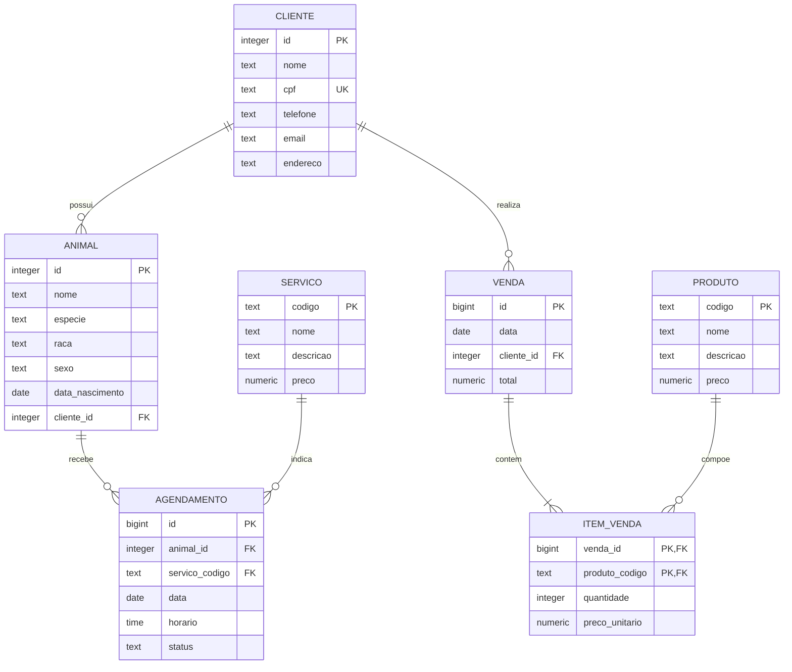

# Pet Shop

Sistema web em Python com PostgreSQL para cadastrar clientes e animais, gerenciar produtos e serviços, registrar vendas e acompanhar agendamentos.

## Executar

Com Python 3 e PostgreSQL ativos e o banco `petshop` criado:

```bash
python3 -m venv .venv
source .venv/bin/activate
python -m pip install -r requirements.txt
python main.py --inicializar   # cria as tabelas (só na primeira vez)
python main.py                 # abre o servidor
```

Abra [http://127.0.0.1:8000](http://127.0.0.1:8000). **Ctrl+C** encerra o servidor.

Por padrão a conexão é `dbname=petshop`. Para usar outra, defina `PETSHOP_DATABASE_URL`, por exemplo `export PETSHOP_DATABASE_URL="host=localhost dbname=petshop user=petshop_app"`. Para mudar a porta, altere `PORTA` em `servidor/servidor.py`.

## Dados de teste

Para testar com dados prontos (3 clientes, 3 animais, 5 produtos, 3 serviços, 2 vendas e 3 agendamentos), rode uma vez com o banco vazio:

```bash
psql -1 -v ON_ERROR_STOP=1 petshop -f banco/massa_teste.sql
```

## Como usar

O menu no topo tem uma página para cada cadastro: clientes, animais, produtos, servicos, agendamentos e vendas. Em cada uma é possível cadastrar, editar e excluir pelos botões da tela.

- **Animais:** informe o `cliente_id` (veja os IDs na página clientes).
- **Agendamentos:** informe o `animal_id` e o `servico_codigo`. O `status` aceita `agendado`, `realizado` ou `cancelado`; para mudá-lo, use *editar*.
- **Vendas:** informe o `cliente_id` e até 5 produtos (código e quantidade). O preço é o do produto no momento da compra, e a venda inteira é desfeita se algum item for inválido.

## Estrutura do projeto

Só Python básico (biblioteca padrão) e o driver `psycopg` para falar com o PostgreSQL. Sem framework. O código é dividido em 6 pastas, e um arquivo importa o outro (por exemplo, `from banco import crud`).

```
main.py              ponto de entrada (abre o servidor ou cria as tabelas)
banco/               tudo do PostgreSQL
    conexao.py         conecta ao banco
    inicializar.py     cria as tabelas
    crud.py            listar, buscar, inserir, atualizar e excluir (usado pelos cadastros)
    opcoes.py          listas de escolha dos formulários
    schema.sql         as tabelas
    massa_teste.sql    dados de teste
cadastros/           um arquivo por cadastro, só descrevendo a tabela e os campos
    clientes.py  animais.py  produtos.py  servicos.py  agendamentos.py
    todos.py           liga cada endereço (/clientes...) ao seu cadastro
vendas/
    venda.py           registrar venda, histórico e busca
paginas/             monta o HTML
    layout.py          cabeçalho, menu e avisos
    componentes.py     lista de escolha, caixa de busca
    tela_cadastro.py   tela de cada cadastro
    tela_vendas.py     tela de vendas
    estilo.css         visual
    carrinho.js        carrinho da venda
servidor/            servidor web (http.server)
    servidor.py        recebe os pedidos e responde
    acoes.py           salvar, editar e excluir
utilitarios/
    formato.py         dinheiro e texto da busca
    arquivos.py        leitura de arquivos
```

## Diagrama entidade-relacionamento


